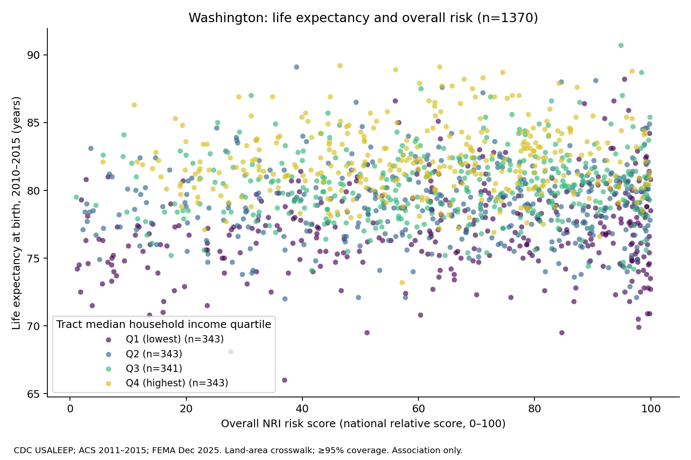
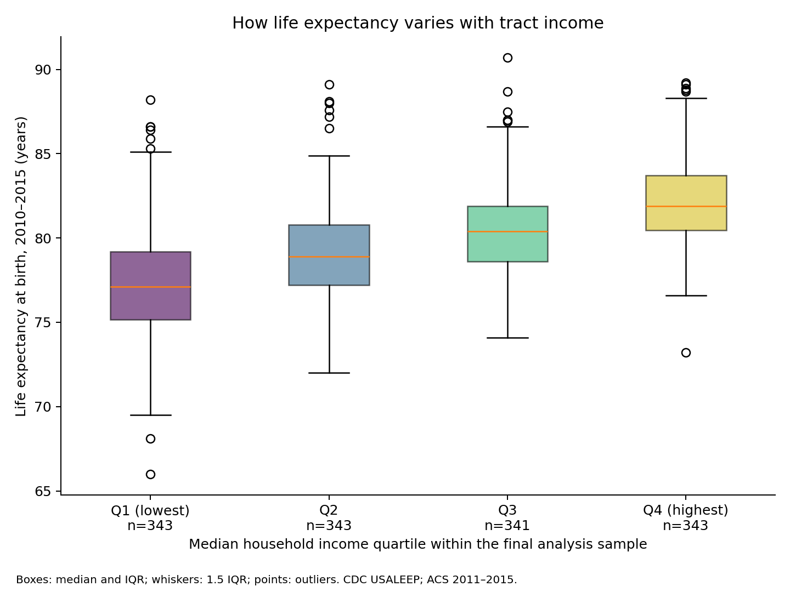
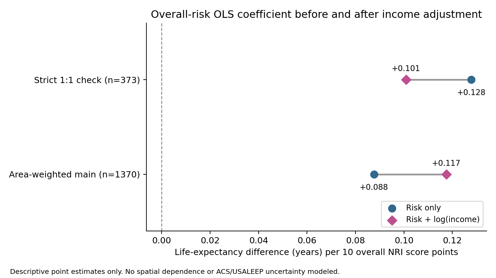

## Title and question

**Climate hazard risk and life expectancy in Washington**

Does climate-related hazard risk still predict life expectancy across Washington State census tracts after controlling for income?

## Team

AACUW Group 7, Fall 2026 — **Intermediate, Route B (visuals)**.

Launch slides list Anumita Basani, Aryan Mahindroo, Stephanie Balderas, Jiselle Vargas Salazar, and Dylan Huynh. TODO: confirm task ownership.

## Data

| Source | What we use | Geography and period |
|---|---|---|
| [CDC/NCHS USALEEP](https://www.cdc.gov/nchs/nvss/usaleep/usaleep.html) | Life expectancy at birth and estimate flags; 1,370 WA records | 2010 tracts, 2010–2015 |
| [Census ACS five-year API](https://api.census.gov/data/2015/acs/acs5.html) | Median household income `B19013_001E`; poverty = `100 × B17001_002E / B17001_001E`; 1,458 records | 2010 tracts, 2011–2015 |
| [FEMA National Risk Index](https://www.arcgis.com/home/item.html?id=9da4eeb936544335a6db0cd7a8448a51) | Overall, drought, wildfire, heat wave, coastal flooding and inland flooding scores; 1,772 records | WA 2020 tract geography; December 2025, v1.20.0 |
| [Census tract relationships](https://www.census.gov/geographies/reference-files/time-series/geo/relationship-files.2020.html) | Land intersections between 2010 and 2020 tracts | 1,458 WA 2010 tracts; 1,784 WA 2020 tracts |

We use the current FEMA Inland Flooding field (`IFLD_*`). We download FEMA's official service response and save its attributes as CSV. Expected annual loss is a dollar total and is **excluded from the crosswalk and main analysis**. Optional WA DOH air-quality data and maps remain future work.

To transfer a 2020 score onto a 2010 tract, each overlapping 2020 tract gets a weight of `AREALAND_PART / AREALAND_TRACT_10`. We average only valid scores, redistributing the weights over the valid parts. Missing or “Not Applicable” scores never become zero. `nri_area_coverage` records the fraction of the whole 2010 tract's land matched to WA FEMA records; each score also has its own valid-area coverage column. Zero-land tracts have undefined land coverage.

Downloads: November 16–17, 2026, Pacific time; ACS completed November 17. Exact URLs, UTC times, sizes and checksums: [data/README.md](data/README.md) and `data/download_log.json`. Raw files stay local.

## How to run

Python 3.10+ recommended (this run used 3.9). From the repo root:

```bash
python3 -m venv .venv
source .venv/bin/activate
python -m pip install -r requirements.txt
# For a fresh ACS download, set CENSUS_API_KEY in your terminal environment.
python src/download.py
python src/clean.py
python notebooks/01_first_look.py
python src/validate.py
```

The ACS download is complete. Validated files are reused without needing a key again. For fresh downloads, get a key from [Census](https://api.census.gov/data/key_signup.html); keep it in your environment and never commit it. `--refresh` redownloads inputs; `--only acs` downloads only ACS. `python src/clean.py --audit-only` checks available geography and FEMA inputs.

The default analysis requires life expectancy, positive household income, overall risk, and at least **95%** matched land and valid overall-score coverage. Change the cutoff with `python src/clean.py --min-nri-coverage 0.99`, then rerun the chart and validation scripts. Hazard correlations and models also require the same fraction of valid land for that particular hazard. This matters especially for coastal flooding.

Cleaning creates `data/clean/project.duckdb`, `tract_analysis.csv`, and `project.sqlite`. The final `tract_analysis` table retains **all 1,458 tracts twice**, once as `sample = 'area_weighted'` and once as `sample = 'strict_1to1'`: **2,916 rows**, keyed by `(sample, GEOID)`. The strict version requires each old tract to overlap only one new tract and that new tract to overlap only that old tract. `included_in_analysis` and `analysis_status` show which rows qualify. `GEOID` is always the 2010 tract ID; `GEOID2020` is populated only where a unique strict match exists.

**Always select one sample and its eligible rows**, so a tract is not counted twice. This query works in DuckDB and SQLite:

```sql
SELECT GEOID, life_expectancy, median_household_income,
       overall_risk_score, nri_area_coverage
FROM tract_analysis
WHERE sample = 'area_weighted' AND included_in_analysis = 1
ORDER BY life_expectancy;
```

To use SQLPad, configure its SQLite connection to a server-accessible copy of `data/clean/project.sqlite`. A local file is not automatically uploaded to a hosted SQLPad instance.

## Findings

The end-to-end run and independent validation passed. The main sample grows from **373 strict tracts to 1,370 area-weighted tracts**.

| Main sample step | Removed at this step | Remaining |
|---|---:|---:|
| All WA 2010 tracts | — | 1,458 |
| Missing USALEEP life expectancy | 88 | 1,370 |
| Missing/nonpositive ACS income | 0 additional | 1,370 |
| Less than 95% matched NRI land coverage | 0 additional | 1,370 |
| Missing/low-coverage overall score | 0 additional | 1,370 |

**Overall NRI risk has a weak positive association with life expectancy that remains after log-income adjustment.** It does not show the expected negative overall-risk pattern in this descriptive analysis.

| Sample | n | Pearson correlation | Risk-only OLS | OLS with log(income) |
|---|---:|---:|---:|---:|
| Area-weighted main | 1,370 | +0.069 | +0.0876 years | +0.1175 years |
| Strict 1:1 check | 373 | +0.100 | +0.1278 years | +0.1009 years |

OLS coefficients are **years per 10 overall risk-score points**. Models are `life expectancy ~ risk` and `life expectancy ~ risk + ln(median household income)`, each with an intercept and equal weight per tract. Land weighting is used only to transfer scores between boundaries. The positive direction holds on the strict sample, but the direction of the change after income adjustment differs. These are point estimates, not significance or causal claims.

Hazards differ: heat-wave risk has a negative income-adjusted coefficient (**−0.152 years per 10 points**, n=1,370), while wildfire has a positive one (**+0.200**, n=1,370). Coastal flooding uses only **1,047** main-sample tracts with at least 95% valid coastal-score coverage. The [correlation table](charts/correlation_table.png) reports each pair's sample size; [model results](charts/income_adjusted_associations.csv) contain all six scores and both samples.







## Repo map

- `src/download.py`: official downloads, response validation and key-free provenance logging.
- `src/clean.py`: input validation, SQL execution, coverage threshold and three exports.
- `src/validate.py`: independent pandas crosswalk, export round trips, pair counts and OLS checks using real inputs.
- `sql/`: geography, ACS and FEMA normalization, area crosswalk, joined samples, example queries.
- `notebooks/01_first_look.py`: runnable notebook alternative; charts, correlations and descriptive OLS.
- `data/raw/`: ignored source files; `data/clean/`: ignored tract exports plus committed small audit summaries.
- `charts/`: four PNGs, pairwise correlation/count CSVs, income summaries and both-sample model results.
- `NOTES.md`: method, detailed checks and limitations; `TODO.md`: teammate starter tasks.

## Limits and next steps

Area averaging assumes a 2020 tract score applies uniformly over its land. People and hazards are not distributed uniformly, and NRI scores are national relative scores; averaging them creates an approximate tract measure, not an official FEMA 2010 score. Coverage measures matched land, not matched population. The 95% cutoff is a documented analysis choice.

NRI's later, mixed-period inputs do not align with 2010–2015 life expectancy. Overall risk includes non-climate hazards and already incorporates social vulnerability/resilience. The models omit spatial dependence, other confounders, ACS/USALEEP uncertainty, and out-of-sample prediction checks. They cannot establish climate-change causation or individual health effects. Strict matching also selects stable-boundary tracts; it is a sensitivity check rather than the main sample.

Next: review captions and hazard-specific findings, consider population-weighted or physical-exposure alternatives, add linked maps and a verified DOH dataset if feasible, and prepare the 5–7 minute talk. Midpoint: November 18; final talk: December 2, 2026.
